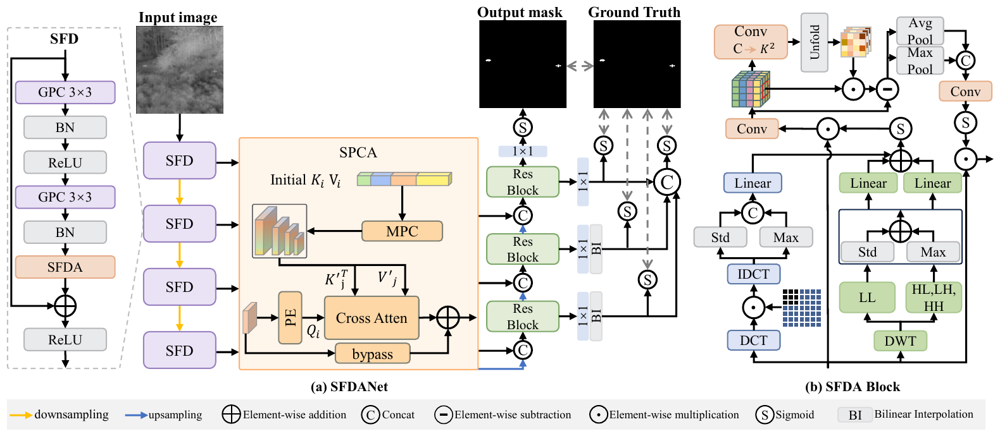

# SFDANet: A Spatial-Frequency Decoupled Attention Network for Infrared Small Target Detection [[Weights](./logs/README.md)]

#### ShiHao Zhang, Xin He, Shuai Yuan, Shaohui Jin, Xiaoheng Jiang, Yang Lu, and Mingliang Xu

### If the implementation of this repository is helpful to you, please star it! ⭐⭐⭐

## Network Architecture



## Repository Structure

```text
SFDANet开源/
├── assets/
│   └── fig2_architecture.png
├── datasets/
│   ├── NUAA-SIRST/
│   │   ├── images/
│   │   │   ├── Misc_1.png
│   │   │   ├── Misc_2.png
│   │   │   └── ...
│   │   ├── masks/
│   │   │   ├── Misc_1.png
│   │   │   ├── Misc_2.png
│   │   │   └── ...
│   │   └── img_idx/
│   │       ├── train_NUAA-SIRST.txt
│   │       └── test_NUAA-SIRST.txt
│   ├── NUDT-SIRST/
│   │   ├── images/
│   │   │   ├── 000001.png
│   │   │   ├── 000002.png
│   │   │   └── ...
│   │   ├── masks/
│   │   │   ├── 000001.png
│   │   │   ├── 000002.png
│   │   │   └── ...
│   │   └── img_idx/
│   │       ├── train_NUDT-SIRST.txt
│   │       └── test_NUDT-SIRST.txt
│   └── IRSTD-1K/
│       ├── images/
│       │   ├── XDU0.png
│       │   ├── XDU1.png
│       │   └── ...
│       ├── masks/
│       │   ├── XDU0.png
│       │   ├── XDU1.png
│       │   └── ...
│       └── img_idx/
│           ├── train_IRSTD-1K.txt
│           └── test_IRSTD-1K.txt
├── logs/
│   ├── NUAA-SIRST/
│   │   └── SFDANet_BCE_softIoU_0.1_1.0_best_miou.pth.tar
│   ├── NUDT-SIRST/
│   │   └── SFDANet_BCE_softIoU_0.1_1.0_best_miou.pth.tar
│   └── IRSTD-1K/
│       └── SFDANet_BCE_softIoU_0.1_1.0_best_miou.pth.tar
├── model/
│   ├── __init__.py
│   └── SFDANet.py
├── dataset.py
├── loss.py
├── metrics.py
├── net.py
├── train.py
├── test.py
└── utils.py
```

## Introduction

SFDANet targets two central difficulties in infrared small target detection
(IRSTD): the strong spatial similarity between targets and background
clutter, and the semantic gap caused by progressive downsampling. The model
jointly models spatial and frequency cues and aligns multi-scale features
through cross-scale semantic interaction.

Our main contributions are:

1. We propose SFDANet for IRSTD to enhance target-clutter separation and
   improve cross-scale semantic consistency for accurate small-target
   localization.
2. We design a stage-wise spatial-frequency decoupling (SFD) module that
   combines Gaussian prior convolution (GPC), DCT-DWT dual-domain channel
   calibration, and content-adaptive high-frequency enhancement (CAHE).
3. We introduce a spatial pyramid cross-attention (SPCA) module with a
   lightweight convolutional bypass, which aligns cross-layer semantics
   with linear complexity while preserving fragile target details.
4. Extensive experiments on public benchmarks demonstrate strong IoU and
   F1 performance with a compact model.

## Usage

### 1. Data

The image and mask files are intentionally not included. Download the
public datasets and place them under `datasets/` following the
`Repository Structure` above.

- **NUAA-SIRST / SIRST-v1**:
  [download](https://github.com/YimianDai/sirst)
- **NUDT-SIRST**:
  [download](https://github.com/YeRen123455/Infrared-Small-Target-Detection)
- **IRSTD-1K**:
  [download](https://github.com/RuiZhang97/ISNet)

The repository keeps only the lightweight `img_idx` split files. The
`images/` and `masks/` directories are empty placeholders.

### 2. Environment

```bash
pip install -r requirements.txt
```

Install a PyTorch build that matches the local CUDA version. The versions
in `requirements.txt` match the reference environment; compatible newer
versions may also work.

### 3. Train

Run from the repository root:

```bash
python train.py \
  --model_names SFDANet \
  --dataset_names NUAA-SIRST \
  --dataset_dir ./datasets \
  --save ./logs \
  --batchSize 16 \
  --lr 0.001 \
  --nEpochs 1000 \
  --pr 150 \
  --lossc BCE_softIoU \
  --optimizer_name Adam_FW2 \
  --BCE_weight 0.1 \
  --softIoU_weight 1
```

The loss weights use their actual meanings:

- `--BCE_weight`: weight of the BCE term.
- `--softIoU_weight`: weight of the Soft-IoU term.

### 4. Test

```bash
python test.py \
  --model_names SFDANet \
  --dataset_names IRSTD-1K \
  --pth_dirs ./logs/IRSTD-1K/SFDANet_BCE_softIoU_0.1_1.0_best_miou.pth.tar \
  --test_size 512
```

Use `--test_size 0` to evaluate at the original image resolution. For
the manuscript protocol on NUAA-SIRST/NUDT-SIRST, use `--test_size 256`.
For IRSTD-1K, use `--test_size 512`.

## Results and Trained Models

Reference results reported in the manuscript:

| Dataset | Resolution | mIoU (%) | Pd (%) | Fa (\(10^{-6}\)) | F1 (%) |
|---|---:|---:|---:|---:|---:|
| NUAA-SIRST | 256 x 256 | 80.13 | 98.10 | 21.13 | 88.97 |
| NUDT-SIRST | 256 x 256 | 97.10 | 99.47 | 0.60 | 98.53 |
| IRSTD-1K | 512 x 512 | 71.32 | 93.94 | 18.50 | 83.26 |

The three released checkpoints are included under `logs/`:

| Dataset | Checkpoint |
|---|---|
| NUAA-SIRST | `logs/NUAA-SIRST/SFDANet_BCE_softIoU_0.1_1.0_best_miou.pth.tar` |
| NUDT-SIRST | `logs/NUDT-SIRST/SFDANet_BCE_softIoU_0.1_1.0_best_miou.pth.tar` |
| IRSTD-1K | `logs/IRSTD-1K/SFDANet_BCE_softIoU_0.1_1.0_best_miou.pth.tar` |

Each checkpoint is about 31.12 MiB. This is below GitHub's 100 MiB
per-file limit, so no Git LFS is required.

## Citation

```bibtex
@article{zhang2026sfdanet,
  title   = {SFDANet: A Spatial-Frequency Decoupled Attention Network for Infrared Small Target Detection},
  author  = {Zhang, ShiHao and He, Xin and Yuan, Shuai and Jin, Shaohui and Jiang, Xiaoheng and Lu, Yang and Xu, Mingliang},
  journal = {IEEE Transactions on Geoscience and Remote Sensing},
  year    = {2026}
}
```

## Contact

Please raise an issue for code questions, or contact
[Shihao Zhang](mailto:zshihao@gs.zzu.edu.cn).

## Acknowledgements

This code is built on
[BasicIRSTD](https://github.com/XinyiYing/BasicIRSTD). We thank the
maintainers of BasicIRSTD and the public IRSTD datasets.
